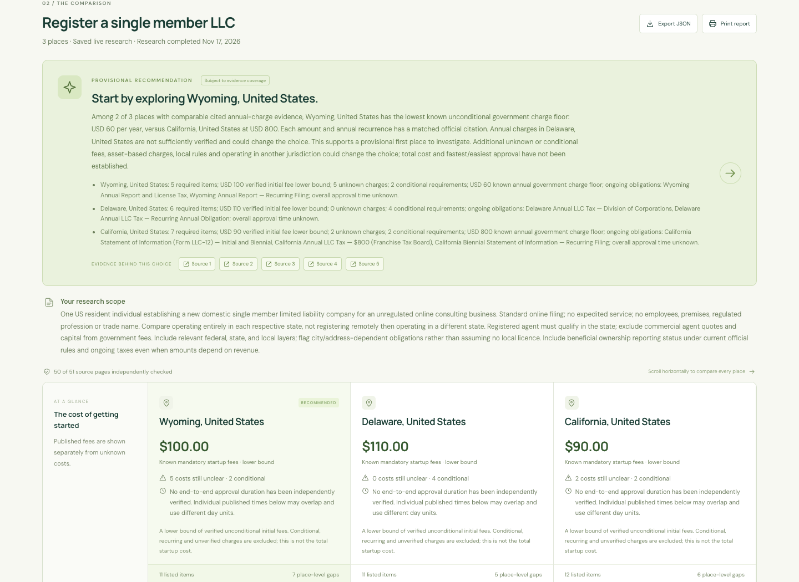

# Compliance Map

**One activity. Three or more places. A comparison you can trace back to the government.**

Compliance Map is a TinyResearch application for comparing the paperwork needed to start an activity across cities, states, or countries. It accepts arbitrary activities and places, researches the official rules, aligns the obligations into common categories, checks citations, and explains what the evidence can support.

Built for the TinyFish **Compliance Map** launch bounty.

**[Open the saved live research gallery](https://sarvesh5273.github.io/compliance-map/)** · [Café demo](https://sarvesh5273.github.io/compliance-map/?example=cafe) · [LLC demo](https://sarvesh5273.github.io/compliance-map/?example=company)

The gallery shows dated, reviewed research snapshots. Run the full app below to compare a new activity or set of places using the live API.



## Run

Requires Node.js 22 or newer and a TinyFish account with TinyResearch enabled.

```sh
npm ci
cp .env.example .env
# Set TINYFISH_API_KEY in .env, or export it in your shell.
npm run dev
```

Open `http://localhost:5173`. The API runs on port 3001. Saved research examples can be viewed without an API key. A new comparison needs a key on the server.

```sh
npm test
npm run build
npm start
```

Production serves the interface and API from the same Express process. `PORT` controls the listening port. A Dockerfile and Render blueprint are included.

## How TinyFish does real work

1. **TinySearch** discovers official authorities for the requested activity and places. Search results are leads; snippets do not prove compliance claims.
2. **TinyResearch** performs the core investigation across jurisdictions. The server starts one deep research run through `POST /v1/automation/run-research-async`, saves its ID, and polls `GET /v1/research-run/{id}`. The query asks for requirements in the same categories, explicit scope assumptions, source passages, fees, processing times, and unresolved questions. The complete original report remains available for audit.
3. **TinyFetch** retrieves the cited government pages with cache tolerance zero. It checks redirects, looks for the quoted passage, records the retrieval date and content hash, and removes unsupported numeric fees or durations from the comparison.

The integration follows the official [TinyResearch API reference](https://docs.tinyfish.ai/tinyresearch/reference), [TinySearch reference](https://docs.tinyfish.ai/tinysearch/reference), and [TinyFetch reference](https://docs.tinyfish.ai/tinyfetch/reference).

No Browser, Agent, or Monitor calls are added merely to increase endpoint count. A new deep run is billed by TinyFish; the current documented rate is $2 per completed run. Research commonly takes 5–20 minutes. Failed creation requests and ambiguous creation responses are distinguished so a timeout cannot silently start duplicate paid research.

## Comparable output

Every location uses the same six categories:

- Business registration
- Operating licences
- Tax and employer registrations
- Premises and safety
- Activity specific requirements
- Renewals and ongoing filings

Each requirement has an applicability state, authority and government level, action steps, dependencies, initial fee, approval time, renewals, ongoing filings, source links, and evidence status. Each citation has an actual check date when independently fetched.

The report separates **required**, **conditional**, **not required**, and **unknown**. Missing evidence is shown as a gap. The same pipeline handles all activities and locations; demonstration inputs are examples, not a dispatch table of hardcoded compliance rules.

## What the recommendation means

Recommendations explain their method and limits. The application does not invent a numerical ease score. It only names a cheapest option when the unconditional initial fees are complete and comparable in the same currency. Otherwise it offers a provisional first place to investigate based on evidence coverage, with the unresolved costs and timing plainly stated.

- A known-fee subtotal is a **lower bound**, not the complete startup cost.
- Conditional fees, recurring taxes, commercial agent charges, rent, capital and uncertain fees are excluded from that subtotal.
- Different currencies are preserved and never silently converted or ranked.
- Approval times are not added together. Independent tasks may overlap, and a formation filing's processing time is not an end-to-end permission to operate.
- Advance notice periods, such as food registration before opening, are not approval service levels.
- A matching source passage proves the passage exists on the official page. It does not certify legal interpretation or exhaustive coverage.
- Ambiguous government domains and inaccessible pages remain unconfirmed.

The report is a research starting point for professional confirmation. It does not verify whether an individual or business currently holds a licence.

## Two live research demos

| Activity | Places | Scope |
| --- | --- | --- |
| Open a small café | Westminster (London), Manchester, Edinburgh | Resident sole trader, existing café premises, no staff, alcohol, outdoor seating, building work or late night service. |
| Register a single member LLC | Wyoming, Delaware, California | US resident founder; domestic LLC operating in that state; ordinary filing; unregulated online consulting; no staff or separate premises. |

Original provider responses and inputs are retained locally during research. Completed checked examples are stored in `data/examples/`. Their status in the interface is explicitly **saved live research**, with the original check dates. Loading one does not claim to check the web again.

Both runs completed on 17 November 2026. They contain 77 listed requirements across six places and 102 source records, of which 87 quoted passages/fragments matched independently fetched official pages. Failed fetches and unmatched excerpts remain visible. These counts measure evidence coverage; they do not certify legal exhaustiveness.

The council's semantic review corrected model mistakes, including Scottish voluntary hygiene-display rules, conditional tax thresholds, online processing charges and conflicting Delaware tax pages. The original provider outputs remain unchanged at `data/examples/cafe-research.json` and `data/examples/company-research.json`. The separately derived review and [live audit](docs/live-evidence-audit.md) record what changed and why.

## Evidence and testing

The 42-test suite exercises misleading government URLs, unsupported fees and times, missing places and categories, duplicate sources, incomplete/ranged costs, incomparable currencies, empty evidence, and non-final research synthesis. See [the independent acceptance review](docs/acceptance-review.md).

The council used separate implementation and review responsibilities: backend and research integration, interface, and independent acceptance/evidence audit. The primary agent integrated the work and exercised the live pipeline.

## Configuration and deployment

The key is read exclusively on the server. It is never returned through the API, included in the frontend bundle, or committed. Set `COMPLIANCE_ACCESS_TOKEN` on a public deployment to protect new paid research; saved examples remain accessible. Use a durable database or volume if preserving newly generated jobs across server restarts is required in your deployment environment.

## Submission

The bounty requires a repo or live build link, both activity demos, notes on TinyResearch, a LinkedIn post tagging TinyFish, and a Discord `#showcase` post. Draft copy is in `docs/submission.md`. A draft does not mean the build or social posts have been submitted.
